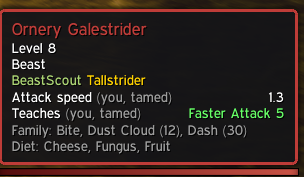
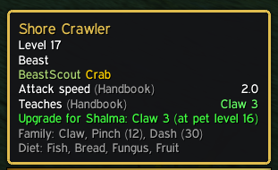
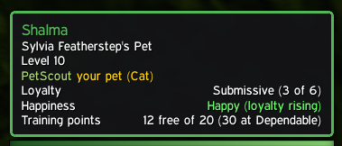
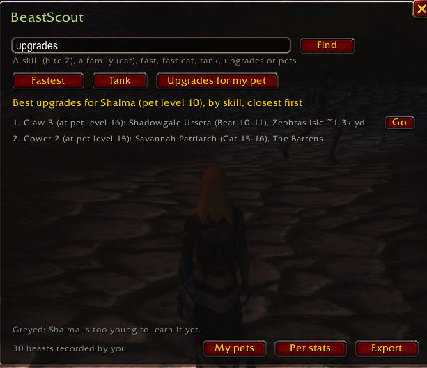
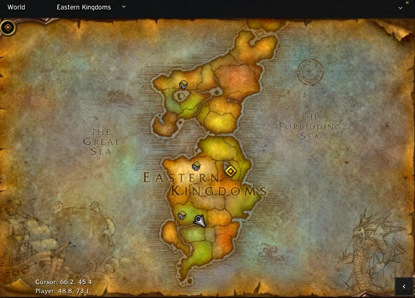

# BeastScout

A small World of Warcraft: Forever addon for hunters. Hover over a wild beast and its tooltip shows what you'd get by taming it:

- **Attack speed:** the swing timer your pet will have. In Forever that's set by the Faster/Slower Attack passive the beast comes with: Faster Attack I–VII gives 1.7, 1.6, 1.5, 1.4, 1.3, 1.2, 1.0; no passive gives 2.0. The tooltip names the passive, e.g. `1.3 (Faster Attack V, Handbook)`. Once a tame has listed a beast's skills and none of them is a speed passive, it shows `2.0 (no attack speed skill)`.
- **Teaches:** the exact ability ranks the beast teaches, including Faster/Slower Attack passives.
- **Family:** the abilities its family can learn and the pet level for each.
- **Diet:** what the family eats.
- **Pet food:** item tooltips say whether your summoned pet will eat it.
- **Upgrade for your pet:** if your current pet could use something the beast teaches, e.g. `Upgrade for Shal'ma: Bite 2 (has 1, 4 TP)`, or `Claw 3 (at pet level 16)` when your pet is too young. Only skills your pet's family can learn and that beat what it already knows are shown. Faster/Slower Attack never are: they only come with a tame.

Hover over your own pet to see its **loyalty**, **happiness** (and whether loyalty is rising) and **free training points**.

The extra lines only show up for hunters. No other addon is needed. It works on any client language: names from the game are matched by spell and map IDs, though BeastScout's own labels are in English.

## What it looks like

  
  

Hovering a beast shows its pet attack speed, what it teaches and where each value came from (left), and whether your current pet could use any of it (right).

Hovering your own pet shows its loyalty, happiness and training points, and what the next loyalty step is worth.

`/beastscout` opens the window. Here: the best upgrades for a level 7 bear, grouped by skill, with the closest beasts first. Greyed rows are ranks the pet is too young for, and skills you've already learned say to train them at Beast Training.

Go (or a [Waypoint] link in chat) puts a waypoint on your map, and it clears itself when you get there.

## Where the data comes from

BeastScout's own data comes first; Hunter's Handbook only fills in what we haven't tracked yet. The tooltip says where each value came from, e.g. `1.5 (players, tamed x3)`.

1. **You:** what BeastScout recorded on your account but you haven't shared yet. It's used over the community data only when it's at least as reliable (a tame beats Beast Lore). Shown as `(you)`, `(you, tamed)` or `(you, Beast Lore)`.
   - **Taming:** right after Tame Beast, it reads your new pet's abilities, and its speed from its Faster/Slower Attack rank. This is the most reliable source.
   - **Beast Lore:** it reads ability ranks from the beast's tooltip after you cast Beast Lore. Since Forever's November 2026 patches, Beast Lore no longer lists a beast's skills, so in practice only tames add them now.
2. **Players:** BeastScout's own data in `Community.lua`: every observation we've accepted, including yours once shared. Shown with how it was observed and how many reports agree, e.g. `(players, tamed x3)`.
3. **Shared in game:** what other BeastScout players online found, shared automatically (see below). Used over the players' data only when it's more reliable. Shown as e.g. `(shared, tamed x2)`.
4. **Hunter's Handbook:** the fallback in `Handbook.lua`, 660 beasts converted from [Hunter's Handbook](https://www.curseforge.com/wow/addons/hunters-handbook) by Wood (GPLv3). Thanks to them for the research. Shown as `(Handbook)`.

As players share more, the community data fills in and the fallback is needed less. `/beastscout help` shows how many beasts' skills and speeds hunters have shared so far, and each release's changelog notes the count.

Family abilities and diets are from [Seemeta](https://seemeta.com/en/wow-forever/pets), game version 1.60.1.

## Install

Copy this folder to `World of Warcraft\_forever_\Interface\AddOns\BeastScout`, so that `BeastScout.toc` sits directly inside it.

## The BeastScout window

Type `/beastscout` or click the minimap button (paw icon; drag it to move, `/beastscout minimap` hides it). The window has:

- a search box that takes anything `find` does: a skill (`bite 2`), a family (`cat`), `fast`, `fast cat`, `tank` or `upgrades`
- quick buttons for **Fastest**, **Tank** and **Upgrades for my pet** (beasts at your level that would teach your current pet something new)
- results with a **Go** button that sets a map waypoint; hover a row to see it in full
- **My pets** (each pet you've had out, with its skills, and Remove), **Pet stats** and **Export** buttons

It opens on your pet's upgrades when a pet is out, otherwise on the fastest beasts. If you use Daylight UI, the window takes its look: its window shell, fonts, buttons and colours. With EllesmereUI or ElvUI, the windows are skinned through their skinning APIs (EllesmereUI's can be turned off per addon in its options). This is new, so tell us if something looks off.

## Commands

Everything in the window also works in chat. `/bs` is a short form of `/beastscout` for every command (`/bs find tank`).

- `/beastscout`: opens the window. `/beastscout help` lists the commands and how many beasts each source covers.
- `/beastscout find upgrades`: beasts at your level that would teach your current pet something new. Grouped by skill: the best rank your pet can learn now from the 2 closest beasts (plus a weaker rank if it's closer), and, greyed, a higher rank within your level that your pet is too young for, with the pet level it needs. Shows training point costs. Skills you've already learned say **train it at Beast Training** instead of naming a beast: BeastScout reads the Beast Training window whenever you open it (Forever shows it in the class trainer window), and uses its pet level requirements over Hunter's Handbook's.
- `/beastscout find cat` (or `wolves`, `birds of prey`, ...): lists beasts of a family with their attack speed, closest first, with waypoints like below. `/beastscout find fast cat` sorts by speed instead, and plain `/beastscout find fast` lists the fastest beasts of any family.
- `/beastscout find tank`: tank families ranked by health and armor bonus (Bear, Boar, Turtle, ...), each with the closest beast you can tame. The bonuses are Classic's ([Highground Gaming](https://www.highgroundgaming.com/best-hunter-pets-in-wow-classic/)); Forever's aren't published yet.
- `/beastscout stats`: your pets' health and armor as BeastScout measured them, by family and level. These are being collected to check the Classic bonuses against Forever.
- Find hides beasts above your level (and says how many). If none are tameable yet, it shows the lowest-level ones greyed out.
- `/beastscout find bite 2`: lists beasts that teach a skill (rank optional, Roman numerals work: `faster attack v`), ones you can tame at your level first, then closest to you, with zone and distance. Results are numbered; click [Waypoint] in chat or type `/beastscout way 2` to put a waypoint on the map. It clears itself when you get there.
- `/beastscout way Ashenvale 42.6 72.1`: found a beast's coordinates on a guide site, or one BeastScout doesn't know yet? This puts them on your map, no other addon needed (the start of a zone's name is enough: `way ashen 42.6 72.1`). Leave out the zone for the one you're in: `/beastscout way 42.6 72.1`. `/beastscout way clear` removes the waypoint.
- `/beastscout find mystmane`: finds beasts by name, or part of one (`find shal` finds Shal'ma), handy for rare spawns.
- `/beastscout find rares`: rare tameable beasts you (or bundled players) have seen. When a rare beast's nameplate shows up near you, BeastScout plays a sound and puts up a warning; rares that aren't in the Hunter's Handbook only get a quiet chat line, since they may not be tameable. Needs enemy nameplates on (V). `/beastscout alert` turns it off or on.
- `/beastscout export`: opens a window with your observations, ready to copy.
- `/beastscout food`: checks pet food for the item under your mouse (or `/beastscout food 117` for an item ID).
- `/beastscout pet`: shows what BeastScout reads from your current pet (spellbook, swing timer).
- `/beastscout debug`: reports each step of a tame in chat, for troubleshooting.
- `/beastscout reset`: forgets your observations.
- `/beastscout sharing`: turns in-game sharing off (or back on).
- `/beastscout share`: sends everything you've recorded now.
- `/beastscout forget shared`: forgets what other players shared.

## Sharing in game

Everyone running BeastScout shares automatically, guild or not, through hidden addon messages on a chat channel BeastScout joins for you (`BeastScoutData`, hidden from your chat windows). You don't need to wait for a release:

- Each new tame or Beast Lore finding goes out right away to every BeastScout player online on your virtual realm. Forever moves you between virtual realms as you change zones or join a party, and custom chat channels don't cross them, so live sharing reaches the players on yours (`/beastscout help` shows which one). What players agree on still reaches everyone through the bundled data in each update.
- When you log in, you send everything you've recorded, and a handful of players online (picked at random, so it stays light however many people use BeastScout) send theirs, so you catch up.
- Your own observations are sent, plus beasts at least two other players saw for themselves and agreed on, so findings keep spreading after the player who made them logs off. Passed-on data is never passed on again, counts half as much as a first-hand report, and shows as `(shared, passed on)`. Shared data stays out of `/beastscout export`.
- Junk is dropped: unknown skills, impossible ranks or families. Each beast keeps the newest reports from up to 10 players. Reports are votes, with a tame counting more than Beast Lore, so one tame beats one Beast Lore but several players outvote a bad report. A level range far from what other players saw is left out.
- Shared data beats your own record only when at least two players saw it themselves.
- Saved shared data stays small: up to 2000 beasts (the least recently heard goes first), and a report nobody has sent for a year is dropped.
- Addon messages carry your character name like any chat, so BeastScout can count one report per player. `/beastscout sharing` turns it off and leaves the channel.
- If the channel can't be joined, BeastScout shares with your guild and group instead.

## Share your observations

Your observations improve everyone's tooltips once they're merged into a release.

1. In game, type `/beastscout export`. The text is already selected: press Ctrl+C.
2. Open [Share beast observations](https://github.com/trevercomb/BeastScout/issues/new?template=observations.yml) (needs a free GitHub account), paste, and submit. Your issue is deleted once its data is merged.

## Maintaining and forks

Forks are welcome. How shared observations are merged into the bundled data, and how releases are built and published, is in [docs/maintaining.md](docs/maintaining.md).

## License

GPLv3, since BeastScout includes data from Hunter's Handbook. See `LICENSE`.
