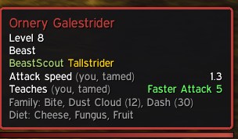
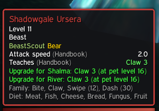
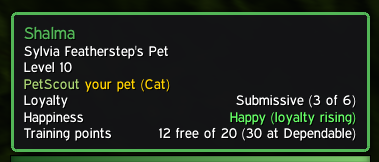
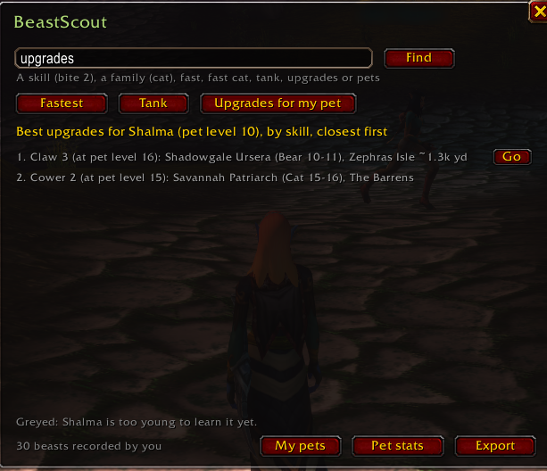
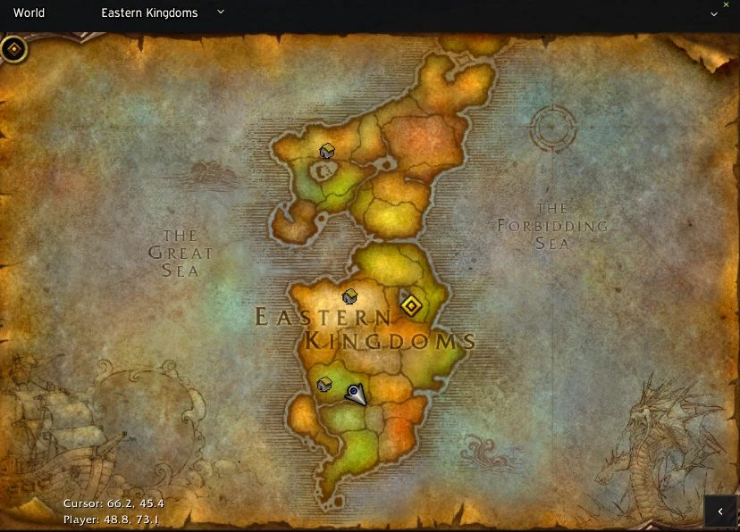

# BeastScout

A small World of Warcraft: Forever addon for hunters. Hover over a wild beast and its tooltip shows what you'd get by taming it:

- **Attack speed:** the swing timer your pet will have. In Forever that's set by the Faster/Slower Attack passive the beast comes with: Faster Attack I–VII gives 1.7, 1.6, 1.5, 1.4, 1.3, 1.2, 1.0; no passive gives 2.0. The tooltip names the passive, e.g. `1.3 (Faster Attack V, Handbook)`.
- **Teaches:** the exact ability ranks the beast teaches, including Faster/Slower Attack passives.
- **Family:** the abilities its family can learn and the pet level for each.
- **Diet:** what the family eats.
- **Pet food:** item tooltips say whether your summoned pet will eat it.
- **Upgrade for your pet:** if your current pet could use something the beast teaches, e.g. `Upgrade for Shal'ma: Bite 2 (has 1, 4 TP)`, or `Claw 3 (at pet level 16)` when your pet is too young. Only skills your pet's family can learn and that beat what it already knows are shown. Faster/Slower Attack never are: they only come with a tame.

Hover over your own pet to see its **loyalty**, **happiness** (and whether loyalty is rising) and **free training points**.

The extra lines only show up for hunters. No other addon is needed. It works on any client language: names from the game are matched by spell and map IDs, though BeastScout's own labels are in English.

## What it looks like

<p>
  
  
</p>

Hovering a beast shows its pet attack speed, what it teaches and where each value came from (left), and whether your current pet could use any of it (right).



Hovering your own pet shows its loyalty, happiness and training points, and what the next loyalty step is worth.



`/beastscout` opens the window. Here: the best upgrades for a level 7 bear, grouped by skill, with the closest beasts first. Greyed rows are ranks the pet is too young for, and skills you've already learned say to train them at Beast Training.



Go (or a [Waypoint] link in chat) puts a waypoint on your map.

## Where the data comes from

BeastScout's own data comes first; Hunter's Handbook only fills in what we haven't tracked yet. The tooltip says where each value came from, e.g. `1.5 (players, tamed x3)`.

1. **You:** what BeastScout recorded on your account but you haven't shared yet. It's used over the community data only when it's at least as reliable (a tame beats Beast Lore). Shown as `(you)`, `(you, tamed)` or `(you, Beast Lore)`.
   - **Taming:** right after Tame Beast, it reads your new pet's abilities and swing timer. This is the most reliable source.
   - **Beast Lore:** it reads ability ranks from the beast's tooltip after you cast Beast Lore.
2. **Players:** BeastScout's own data in `Community.lua`: every observation we've accepted, including yours once shared. Shown with how it was observed and how many reports agree, e.g. `(players, tamed x3)`.
3. **Your guild:** what guildmates running BeastScout found, shared in game (see below). Used over the players' data only when it's more reliable. Shown as e.g. `(guild, tamed x2)`.
4. **Hunter's Handbook:** the fallback in `Handbook.lua`, 660 beasts converted from [Hunter's Handbook](https://www.curseforge.com/wow/addons/hunters-handbook) by Wood (GPLv3). Thanks to them for the research. Shown as `(Handbook)`.

As players share more, the community data fills in and the fallback is needed less.

Family abilities and diets are from [Seemeta](https://seemeta.com/en/wow-forever/pets), game version 1.60.1.

## Install

Copy this folder to `World of Warcraft\_forever_\Interface\AddOns\BeastScout`, so that `BeastScout.toc` sits directly inside it.

## The BeastScout window

Type `/beastscout` or click the minimap button (paw icon; drag it to move, `/beastscout minimap` hides it). The window has:

- a search box that takes anything `find` does: a skill (`bite 2`), a family (`cat`), `fast`, `fast cat`, `tank` or `upgrades`
- quick buttons for **Fastest**, **Tank** and **Upgrades for my pet** (beasts at your level that would teach your current pet something new)
- results with a **Go** button that sets a map waypoint; hover a row to see it in full
- **My pets** (each pet you've had out, with its skills, and Remove), **Pet stats** and **Export** buttons

It opens on your pet's upgrades when a pet is out, otherwise on the fastest beasts.

## Commands

Everything in the window also works in chat:


- `/beastscout`: opens the window. `/beastscout help` lists the commands and how many beasts each source covers.
- `/beastscout find upgrades`: beasts at your level that would teach your current pet something new. Grouped by skill: the best rank your pet can learn now from the 2 closest beasts (plus a weaker rank if it's closer), and, greyed, a higher rank within your level that your pet is too young for, with the pet level it needs. Shows training point costs. Skills you've already learned say **train it at Beast Training** instead of naming a beast: BeastScout reads the Beast Training window whenever you open it (Forever shows it in the class trainer window), and uses its pet level requirements over Hunter's Handbook's.
- `/beastscout find cat` (or `wolves`, `birds of prey`, ...): lists beasts of a family with their attack speed, closest first, with waypoints like below. `/beastscout find fast cat` sorts by speed instead, and plain `/beastscout find fast` lists the fastest beasts of any family.
- `/beastscout find tank`: tank families ranked by health and armor bonus (Bear, Boar, Turtle, ...), each with the closest beast you can tame. The bonuses are Classic's ([Highground Gaming](https://www.highgroundgaming.com/best-hunter-pets-in-wow-classic/)); Forever's aren't published yet.
- `/beastscout stats`: your pets' health and armor as BeastScout measured them, by family and level. These are being collected to check the Classic bonuses against Forever.
- Find hides beasts above your level (and says how many). If none are tameable yet, it shows the lowest-level ones greyed out.
- `/beastscout find bite 2`: lists beasts that teach a skill (rank optional, Roman numerals work: `faster attack v`), ones you can tame at your level first, then closest to you, with zone and distance. Results are numbered; click [Waypoint] in chat or type `/beastscout way 2` to put a waypoint on the map.
- `/beastscout export`: opens a window with your observations, ready to copy.
- `/beastscout food`: checks pet food for the item under your mouse (or `/beastscout food 117` for an item ID).
- `/beastscout pet`: shows what BeastScout reads from your current pet (spellbook, swing timer).
- `/beastscout debug`: reports each step of a tame in chat, for troubleshooting.
- `/beastscout reset`: forgets your observations.
- `/beastscout sharing`: turns in-game sharing with your guild and group off (or back on).
- `/beastscout share`: sends everything you've recorded to your guild now.
- `/beastscout forget guild`: forgets what guildmates shared.

## Sharing in game

Guildmates running BeastScout share automatically through hidden addon messages, so you don't need to wait for a release:

- Each new tame or Beast Lore finding goes to your guild (and your group) right away.
- Once a day, everything you've recorded goes to your guild, so new members catch up.
- Only your own observations are sent, never what others shared with you, and guild data stays out of `/beastscout export`.
- Addon messages carry your character name like any guild chat, so guildmates' BeastScout can count one report per player. `/beastscout sharing` turns it off.

## Share your observations

Your observations improve everyone's tooltips once they're merged into a release.

1. In game, type `/beastscout export`. The text is already selected: press Ctrl+C.
2. Open [Share beast observations](https://github.com/trevercomb/BeastScout/issues/new?template=observations.yml) (needs a free GitHub account), paste, and submit. Your issue is deleted once its data is merged.

## Maintainer: merging shared observations

1. Pull submitted issues into `contributions/`. Each line is checked: known family and abilities, ranks 1–10, speed 0.8–3.5, sane levels. Bad lines are rejected and listed. Files don't name anyone: each player's author is a salted hash (the salt stays in `tools/local.json`, which isn't committed), and files are named by date, not issue number. Each issue is **deleted** once it's read and saved, so the public issue (with the username) doesn't stay around; `--keep-issues` skips that.

   ```
   python tools/pull_contributions.py
   ```

2. Rebuild the data files:

   ```
   python tools/build_bestiary.py
   ```

   This writes `Community.lua` from everything in `contributions/`, and `Handbook.lua` from the copy in `vendor/HuntersHandbook/`. For each beast and field, the most trusted source wins (tame > Beast Lore), then the value most reports agree on. Speeds only count when measured on a fresh tame; a wild beast's own swing timer doesn't match its pet's. Level ranges only widen.

3. Review the `Community.lua` diff, commit, release, and close the issues (the pull script prints the commands).

Run the tests before releasing: `lua tests/run.lua`, `python tests/test_build.py`, `python tests/test_sync.py` and `python tests/test_pull.py`.

### Your own observations, without the form

If you play with the addon folder linked to this repo, `tools/sync_local.py` reads BeastScout's saved data straight from your WoW folder, writes it to `contributions/local.lua` and rebuilds `Community.lua`. The game saves on `/reload` and logout, so a second `/reload` shows the result.

```
python tools/sync_local.py --wtf "<WoW>/_forever_/WTF"   # first time; remembered in tools/local.json (not committed)
python tools/sync_local.py --watch                       # keep running while you play
```

Your observations go through the same checks and merge rules as shared ones, and `contributions/local.lua` gets committed like any other contribution.

### Releasing

Releases are built by `.github/workflows/release.yml` with the [BigWigs packager](https://github.com/BigWigsMods/packager); `.pkgmeta` keeps tests, tools and data sources out of the zip.

One-time setup:

1. Create the project on CurseForge (WoW Forever) and note its **Project ID**.
2. Add `## X-Curse-Project-ID: <id>` to `BeastScout.toc`.
3. Create a CurseForge API token (account settings, API tokens) and save it in this repo as the secret `CF_API_KEY` (Settings, Secrets and variables, Actions).

Then each release is: bump `## Version` in `BeastScout.toc`, add the version's notes at the top of `CHANGELOG.md` (that file is the release notes), commit, and push a tag:

```
git tag v0.11.0
git push origin v0.11.0
```

The workflow runs the tests, builds the zip, makes a GitHub release and uploads to CurseForge.

## License

GPLv3, since BeastScout includes data from Hunter's Handbook. See `LICENSE`.
