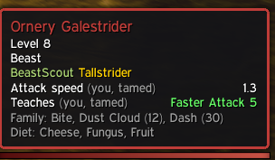
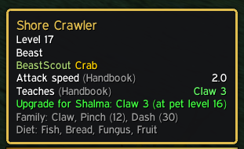
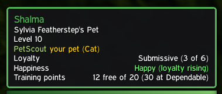
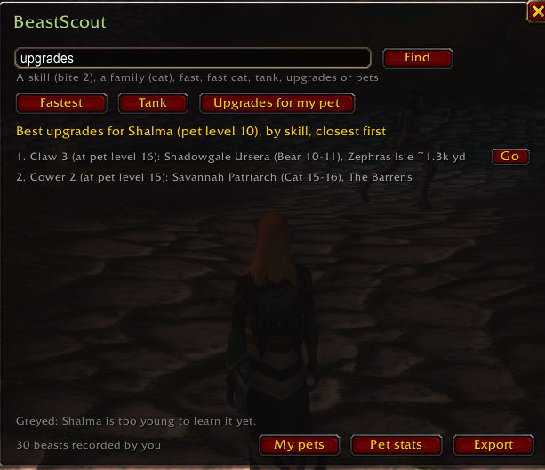

**BeastScout** shows hunters what a wild beast would make as a pet, right in its tooltip, and helps you find the best beasts and upgrades near you.

 

## Beast tooltips

Hover any tameable beast to see:

- **Attack speed** your pet will have. In Forever it comes from the Faster/Slower Attack passive the beast carries (Faster Attack V = 1.3, no passive = 2.0), and the tooltip names it.
- **Skills it teaches**, with ranks.
- **Family abilities** and the pet level for each, plus **diet**.
- **Pet food** on item tooltips: whether your summoned pet will eat it.
- **Upgrades for your current pet**, e.g. *Upgrade for Shalma: Claw 2 (new)*, or *Claw 3 (at pet level 16)* when your pet is too young.

Every value says where it came from: *(you, tamed)*, *(players, tamed x3)* or *(Handbook)*. Every tame you share helps: **/beastscout help** shows how many beasts hunters like you have shared so far.

## Your pet

Hover your own pet for its **loyalty** (with its level), **happiness** and whether loyalty is rising, and **training points**, including what the next loyalty step is worth.

## The BeastScout window

Type **/beastscout** or click the minimap button:

- **Upgrades for my pet:** grouped by skill, the closest beasts that teach something your pet can use, with training point costs. Skills you've already learned say to train them at Beast Training instead.
- **Fastest:** the fastest beasts you can tame, any family (or *fast cat*, *fast wolf*...).
- **Tank:** tank families ranked by health and armor, with the closest one you can tame. Forever's bonuses aren't published, so every BeastScout player's pets are measured and shared to work them out.
- **This zone:** beasts in your zone that would teach any of your pets something new. BeastScout also lists them by itself when you arrive in a zone (**/beastscout zone auto** turns that off). Pets you haven't had out for 30 days are left out.
- **Ignore a skill:** **/beastscout ignore cower** stops suggesting a skill for the pet you have out (Cower on a tank, say); ignore it again to bring it back. Each pet keeps its own list, and **Hide** on an Upgrades for my pet row does the same. **Hidden** lists every pet's hidden skills, with **Show** to bring one back.
- **Search** a skill (*bite 2*), a family (*cat*), a beast's name (*mystmane*, or just *shal*), and more.
- **Go** puts a waypoint on your map; it clears when you get there. Beasts above your level are hidden.
- **Daylight UI** users get the window in Daylight UI's look.
- **EllesmereUI** and **ElvUI** users get the window in their UI's skin (new: tell us how it looks).

## Rare beast alert and wishlist

When a rare tameable beast's nameplate (or one on your wishlist) shows up near you, BeastScout plays a sound and puts up an on-screen warning, so you don't walk past it. Rares that may not be tameable (not in the Hunter's Handbook) only get a quiet chat line. Needs enemy nameplates on (V). **/beastscout find rares** lists the rares you've seen, **/beastscout alert** turns the alert off, and **/beastscout alert test** tries it on your target. Put any beast on your wishlist with **/beastscout wish** (your target) or **/beastscout wish mystmane**, and **/beastscout wishlist** lists them.

## Food vendors

BeastScout remembers the food and drink of every vendor you open, and **/beastscout vendors** lists the closest ones selling food your summoned pet eats, with waypoints. It asks the game what your pet eats, so one visit covers all your pets.

## Data that gets better as you play

BeastScout records what it sees: your tames (the pet's real abilities) and your Beast Training list with real costs. Your own observations override the bundled data. Share them with **/beastscout export** and they're merged into everyone's next update. BeastScout players online also share with each other in game automatically, guild or not (**/beastscout sharing** turns it off). Sharing through export is private: your name isn't stored with your data, and your submission is deleted once it's merged.

Built-in data: beast data from **Hunter's Handbook** by Wood (GPLv3), family abilities from Seemeta, Classic family bonuses from Highground Gaming. Thanks to all of them.

## Commands

/beastscout (window) · /beastscout find &lt;skill, family, name, fast, tank, upgrades, rares&gt; · /beastscout zone · /beastscout ignore &lt;skill&gt; · /beastscout wish · /beastscout wishlist · /beastscout vendors · /beastscout alert · /beastscout way &lt;number, or zone x y, or x y&gt; · /beastscout way clear · /beastscout export · /beastscout sharing · /beastscout stats · /beastscout minimap · /beastscout help

Short form: **/bs** works for every command (/bs find tank).

Source, issues and sharing observations: [github.com/trevercomb/BeastScout](https://github.com/trevercomb/BeastScout)
