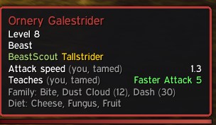
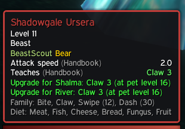
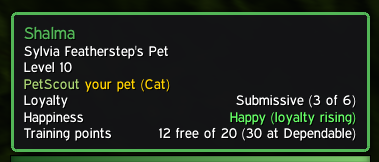
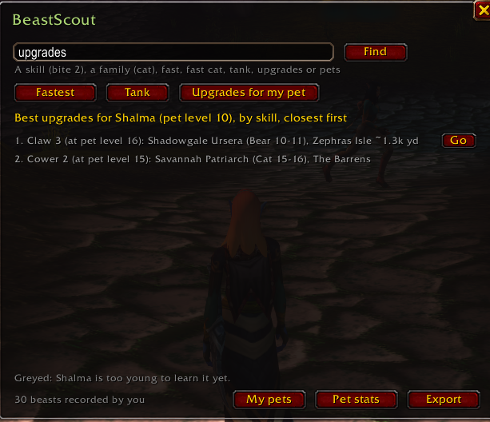

**BeastScout** shows hunters what a wild beast would make as a pet, right in its tooltip, and helps you find the best beasts and upgrades near you.

 

## Beast tooltips

Hover any tameable beast to see:

- **Attack speed** your pet will have. In Forever it comes from the Faster/Slower Attack passive the beast carries (Faster Attack V = 1.3, no passive = 2.0), and the tooltip names it.
- **Skills it teaches**, with ranks.
- **Family abilities** and the pet level for each, plus **diet**.
- **Pet food** on item tooltips: whether your summoned pet will eat it.
- **Upgrades for your current pet**, e.g. *Upgrade for Shalma: Claw 2 (new)*, or *Claw 3 (at pet level 16)* when your pet is too young.

Every value says where it came from: *(you, tamed)*, *(players, tamed x3)* or *(Handbook)*.

## Your pet

Hover your own pet for its **loyalty** (with its level), **happiness** and whether loyalty is rising, and **training points**, including what the next loyalty step is worth.

## The BeastScout window

Type **/beastscout** or click the minimap button:

- **Upgrades for my pet:** grouped by skill, the closest beasts that teach something your pet can use, with training point costs. Skills you've already learned say to train them at Beast Training instead.
- **Fastest:** the fastest beasts you can tame, any family (or *fast cat*, *fast wolf*...).
- **Tank:** tank families ranked by health and armor, with the closest one you can tame.
- **Search** a skill (*bite 2*), a family (*cat*), and more.
- **Go** puts a waypoint on your map. Beasts above your level are hidden.

## Data that gets better as you play

BeastScout records what it sees: your tames (the pet's real abilities and swing timer), Beast Lore, and your Beast Training list with real costs. Your own observations override the bundled data. Share them with **/beastscout export** and they're merged into everyone's next update. Guildmates running BeastScout also share with each other in game automatically (**/beastscout sharing** turns it off). Sharing through export is private: your name isn't stored with your data, and your submission is deleted once it's merged.

Built-in data: beast data from **Hunter's Handbook** by Wood (GPLv3), family abilities from Seemeta, Classic family bonuses from Highground Gaming. Thanks to all of them.

## Commands

/beastscout (window) · /beastscout find &lt;skill, family, fast, tank, upgrades&gt; · /beastscout way &lt;number&gt; · /beastscout export · /beastscout sharing · /beastscout stats · /beastscout minimap · /beastscout help

Short form: **/bs** works for every command (/bs find tank).

Source, issues and sharing observations: [github.com/trevercomb/BeastScout](https://github.com/trevercomb/BeastScout)
